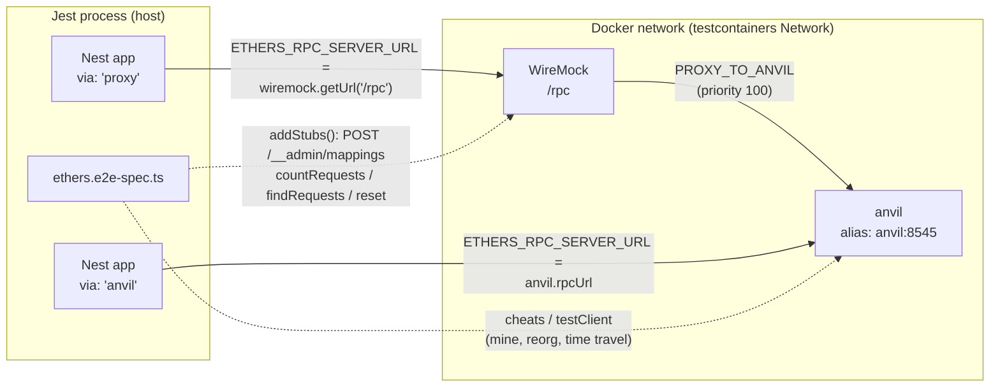
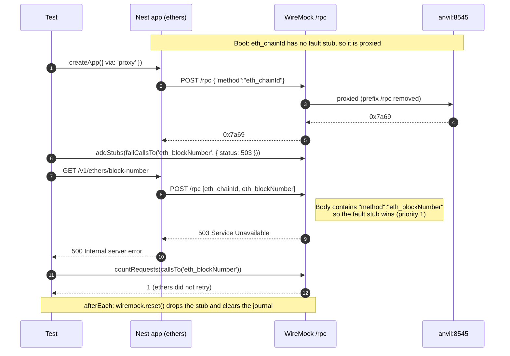

## Testcontainers

Anvil:
https://www.npmjs.com/package/@hellaweb3/foundryanvil-testcontainers-nodejs

Solana test validator:
https://www.npmjs.com/package/@beeman/testcontainers

WireMock:
https://www.npmjs.com/package/@hellaweb3/wiremock-testcontainers-nodejs

Run the e2e suite (Docker must be running):

```shell
pnpm test:e2e
```

----

## Ethers e2e: WireMock as a fault-injecting proxy in front of anvil

`test/ethers.e2e-spec.ts` boots the full `AppModule` and checks the ethers
REST, GraphQL, WebSocket and SSE APIs against a real EVM node,
[anvil](https://getfoundry.sh/anvil/overview).

A real node can't produce transport failures such as a `503`, a dropped
connection, a slow response or rate limiting. For those, WireMock sits between
the app and anvil. By default it forwards every JSON-RPC request unchanged, so
**anvil produces every response**. WireMock never fakes chain data; it only
injects faults.

### Topology



PostgreSQL and the Solana test validator are also started, because
`AppModule` needs them to boot. They are left out of the diagram.

- **Direct tests** (`createApp()`) point the app's ethers provider straight at
  `anvil.rpcUrl`.
- **Proxy tests** (`createApp({ via: 'proxy' })`) point it at
  `wiremock.getUrl('/rpc')`.
- In both cases the spec drives the chain through the anvil test client
  (`anvil.mine()`, `anvil.cheats…`, `anvil.testClient.reorg()`) and uses the
  node itself as the oracle for expected values.

### Request flow in a fault test



### How it works

Supporting helpers live in `test/support/rpc-faults.ts`.

1. **Shared Docker network.** `useAnvil()` receives a small `start()` function
   that first creates a testcontainers `Network`. It then starts anvil on that
   network with the alias `anvil`. The WireMock container joins the same
   network, so from inside WireMock anvil is reachable at
   `http://anvil:8545`. Ports are mapped to the host as usual for the app and
   the test client.
2. **The transparent proxy (`PROXY_TO_ANVIL`).** This stub is registered
   before start with
   `withMapping('json-rpc/proxy-to-anvil', { json: PROXY_TO_ANVIL })`. It
   matches any request to `/rpc` at low priority (`100`) and answers with
   `proxyBaseUrl: 'http://anvil:8545'` and `proxyUrlPrefixToRemove: '/rpc'`.
   Without any other stub, the app sees anvil exactly as if it were connected
   directly.
3. **Fault stubs added at runtime (`failCallsTo`).** A test that needs a
   failure registers a high-priority stub (`1`) with `addStubs()`, which POSTs
   it to `wiremock.getMappingUrl()`. The stub matches only requests whose body
   contains `"method":"<rpc method>"`, so every other call still reaches anvil.
   The response can be anything WireMock supports:
   - a status: `{ status: 503 }`
   - a network fault: `{ fault: 'CONNECTION_RESET_BY_PEER' }` or
     `{ fault: 'EMPTY_RESPONSE' }`
   - a malformed body: `{ status: 200, body: '{"jsonrpc":"2.0",' }`
   - latency on top of real data:
     `{ ...PROXY_TO_ANVIL.response, fixedDelayMilliseconds: 1500 }`
   - a stateful scenario, such as a `429` returned once
     (`scenarioName` / `requiredScenarioState` / `newScenarioState`) before
     requests are proxied again.
4. **Request verification.** WireMock records every request it receives.
   `countRequests(callsTo(method))` asserts how many HTTP requests carried a
   call (for example, no retry after a `503`, or exactly one retry after a
   `429`). `recordedRpcCalls()` flattens recorded bodies into JSON-RPC calls,
   for example to check that the finalized endpoint asks for
   `eth_getBlockByNumber` with `['finalized', false]`.
5. **Isolation between tests.**
   - `useAnvil` restores an anvil snapshot after every test, so mined blocks,
     reorgs and time travel never leak.
   - `afterEach` closes every Nest app and calls `wiremock.reset()`, which
     removes runtime fault stubs (the proxy stub stays), resets scenarios and
     clears the request journal.

### Gotchas

- **ethers batches requests.** After network detection, ethers v6 sends an
  `eth_chainId` re-check together with most calls in one JSON array. Fault
  stubs therefore match on `bodyPatterns: [{ contains: '"method":"…"' }]`,
  which works for single and batched bodies. A fault hits the whole batch,
  just like a real HTTP failure would.
- **Never fault `eth_chainId`.** The app calls `getNetwork()` in
  `EthersSdkService.onModuleInit`. If the node never answers `eth_chainId`,
  ethers retries forever and the app never boots. Register boot-time faults
  only for other methods (see the "still reports Connected" test).
- **Boot traffic is in the journal.** Call `wiremock.resetRequests()` after
  `createApp()` when a test asserts on the total number of calls.
- **Finality is configured.** anvil reports
  `finalized = max(0, head − 2 · slotsInAnEpoch)`. The spec sets
  `.mining.withSlotsInAnEpoch(1)`, so the finalized block lags the head by
  exactly `FINALITY_LAG = 2` blocks.
- **testcontainers versions must match.** Both `@hellaweb3/*` libraries
  depend on `testcontainers@^12`. The project's `testcontainers` and
  `@testcontainers/postgresql` must be on the same major version, otherwise a
  `Network` from one copy can't be passed to containers from the other.

### Adding a fault test

```ts
it('fails with 500 when eth_getBlockByNumber drops the connection', async () => {
  const app = await createApp({ via: 'proxy' });
  await addStubs(
    wiremock,
    failCallsTo('eth_getBlockByNumber', { fault: 'CONNECTION_RESET_BY_PEER' }),
  );

  await request(app.getHttpServer())
    .get('/v1/ethers/finalized-block')
    .expect(500);

  expect(
    await wiremock.countRequests(callsTo('eth_getBlockByNumber')),
  ).toBe(1);
});
```

----

## Wiremock

Wiremock can capture and replay API calls to mock external services.

### Record and playback:

Use record and playback to capture mocks from external API calls

- Read for more context: https://wiremock.org/docs/record-playback/

#### Capturing mocks:

Update `.env` file to point to Wiremock container which will proxy requests to the sandbox.

```dotenv
REAP_BASE_URL=http://localhost:8080
```

Run the project

```shell
pnpm dev
```

Start up Wiremock Docker container with recording enabled.

Run this in the project root:

```shell
docker run -it --rm \
-p 8080:8080 \
-v $PWD/test/__mocks__/wiremock:/home/wiremock \
--name wiremock \
wiremock/wiremock:latest \
--enable-browser-proxying \
--proxy-all="https://sandbox.api.caas.reap.global" \
--preserve-host-header=false \
--trust-all-proxy-targets \
--record-mappings --verbose
```

**Navigate to:**  http://localhost:8080/__admin/recorder/

Enter target URL. Base URL from `.env` file.

- Reap: https://sandbox.api.caas.reap.global

Press `Record` button.

The files will be saved to `./test/__mocks__/wiremock`